# MWHEBA 2.0 | Website Inventory & Hierarchy Audit

**Document ID:** AUD-DOC-01  
**Phase:** Phase 0 (Discovery & Live-Site Audit)  
**Status:** Completed — Pending Owner Approval  
**Audit Target:** `https://mwheba.com/`  

---

## 1. Inventory Methodology & Scope

The inventory of `mwheba.com` was conducted via automated, read-only HTTP inspection and WordPress REST API endpoint introspection (`/wp-json/wp/v2/`). Inspection occurred at a rate-limited pace (<1 request/second) without inducing server stress.

### Discovery Vectors Evaluated
1. **Robots.txt & XML Sitemaps:** Parsed `https://mwheba.com/robots.txt` and sitemap index `https://mwheba.com/sitemaps.xml` (referencing `post-sitemap1.xml`, `page-sitemap1.xml`, and `portfolio_category-sitemap1.xml`).
2. **WordPress REST API (`/wp-json/wp/v2/`):** Queried public core collections: `pages`, `posts`, `portfolio`, `product`, `product_cat`, and `portfolio_category`.
3. **HTTP Header & Response Verification:** Every individual URL was probed for HTTP response code, Content-Type, canonical link header, and DOM structure.

---

## 2. High-Level Inventory Breakdown

| Content Type | Count | Status | Description / Notes | Classification |
|---|---|---|---|---|
| **Standard Corporate Pages (EN)** | 16 | Published (200 OK) | English corporate pages residing at root (`/`, `/about/`, `/services/...`, `/contact-us/`, `/pricing/`, etc.) | `Verified` |
| **Standard Corporate Pages (AR)** | 15 | Published (200 OK) | Arabic mirror pages under `/ar/` subdirectory with Arabic URL slugs (`/ar/خدماتنا/`, `/ar/عن-موهبة/`, etc.) | `Verified` |
| **E-Commerce Endpoints (WooCommerce)** | 4 | Published (200 OK) | Default WooCommerce system pages (`/shop/`, `/cart/`, `/checkout/`, `/my-account/`) | `Verified` |
| **Blog Posts** | 3 | Published (200 OK) | WordPress default & demo posts (`hello-world`, `test-blog`, `test-blog-2`) | `Verified` |
| **Portfolio Custom Post Type** | 1 | Published (200 OK) | Single draft/dummy portfolio post (`/portfolio/test/`) | `Verified` |
| **WooCommerce Products** | 7 | Published (200 OK) | 6 theme demo products (*Vintage Typewriter*, etc.) + 1 test package (*Social Media Managemnt Package*) | `Verified` |
| **Portfolio Categories** | 6 | Published (200 OK) | Taxonomy archives (`brand-identity`, `digital-marketing`, `media-production`, `printing`, `ui-ux-design`, `web-design`) | `Verified` |
| **System Endpoints** | 2 | Published (200 OK) | `/robots.txt` and `/sitemaps.xml` | `Verified` |
| **Currently Discovered Public URLs** | **54** | **100% 200 OK** | Discovered public footprint recorded in `docs/audit/02-url-inventory.csv`. Full historical and indexed URL inventory requires validation against Google Search Console and server access logs. | `Verified` (Public Set) |

---

## 3. Site Structure & Hierarchy Mapping

### A. Corporate Website Hierarchy (English vs. Arabic Mirror)

The current live site implements a bilingual structure using WordPress subpaths. English lives at the root domain (`https://mwheba.com/`), while Arabic is isolated under `https://mwheba.com/ar/`.

```mermaid
graph TD
    Root["https://mwheba.com/ (EN Root)"]
    AR_Root["https://mwheba.com/ar/ (AR Root)"]
    
    Root --> About_EN["/about/"]
    AR_Root --> About_AR["/ar/عن-موهبة/"]
    
    Root --> Services_EN["/services/"]
    AR_Root --> Services_AR["/ar/خدماتنا/"]
    
    Services_EN --> S1_EN["/services/brand-identity/"]
    Services_EN --> S2_EN["/services/web-development/"]
    Services_EN --> S3_EN["/services/ui-ux-design/"]
    Services_EN --> S4_EN["/services/digital-marketing/"]
    Services_EN --> S5_EN["/services/media-production/"]
    Services_EN --> S6_EN["/services/printing/"]
    
    Services_AR --> S1_AR["/ar/خدماتنا/هوية-العلامة-التجارية/"]
    Services_AR --> S2_AR["/ar/خدماتنا/تطوير-المواقع/"]
    Services_AR --> S3_AR["/ar/خدماتنا/تصميم-واجهة-المستخدم/"]
    Services_AR --> S4_AR["/ar/خدماتنا/التسويق-الرقمي/"]
    Services_AR --> S5_AR["/ar/خدماتنا/إنتاج-الوسائط/"]
    Services_AR --> S6_AR["/ar/خدماتنا/الطباعة/"]
    
    Root --> Proj_EN["/our-projects/"]
    AR_Root --> Proj_AR["/ar/مشاريعنا/"]
    
    Root --> Contact_EN["/contact-us/"]
    AR_Root --> Contact_AR["/ar/تواصل-معنا/"]
    
    Root --> Careers_EN["/careers/"]
    AR_Root --> Careers_AR["/ar/الوظائف/"]
    
    Root --> Blog_EN["/blog/"]
    AR_Root --> Blog_AR["/ar/المدونة/"]
    
    Root --> Privacy_EN["/privacy-policy/"]
    AR_Root --> Privacy_AR["/ar/سياسة-الخصوصية/"]
    
    Root --> Refund_EN["/refund_returns/"]
    AR_Root --> Refund_AR["/ar/الاسترداد-والإرجاع/"]
    
    Root --> Pricing_EN["/pricing/ (No AR counterpart)"]
    Root --> Shop_EN["/shop/ (No AR counterpart)"]
```

### Key Structural Findings
1. **Asymmetry in Pricing & E-Commerce:**
   - English has `/pricing/` (ID: 160) and `/shop/` (ID: 1578).
   - Arabic has **no** `/pricing/` or `/shop/` counterpart in the live database. `[Verified]`
2. **Arabic URL Structure & Canonical Resolution (`Verified`):**
   - Arabic slugs are UTF-8 Arabic words (`/ar/خدماتنا/تطوير-المواقع/`). When properly requested, every Arabic page responds with HTTP 200 and renders its own unique Arabic `<title>` tag and self-referencing canonical link.
   - Initial crawler artifacts that reflected homepage metadata were traced to a double percent-encoding issue (`%25d8...`) causing server-side fallback redirects. Re-audit with single-encoded paths proved that each Arabic page is structurally independent.
   - Like English inner pages, all 14 Arabic inner pages lack semantic `<h1>` tags and meta descriptions (except the Arabic refund policy).
3. **Inconsistent URL naming:**
   - English refund page is `/refund_returns/` with an underscore, violating modern SEO hyphen conventions. `[Verified]`
   - English projects page is `/our-projects/` while service pages are `/services/...`.

---

## 4. E-Commerce & Demo Content Inventory

The WordPress instance includes WooCommerce tables and default sample data. Introspection of `/wp-json/wp/v2/product` confirmed seven product items:

| Product ID | Title | Slug | Price (EGP) | Category | Real vs. Demo Assessment |
|---|---|---|---|---|---|
| **1699** | Social Media Managemnt Package | `social-media-managemnt-package` | 100 EGP (Sale: 80 EGP) | Uncategorized | **Service Test:** Agency test product with typo in slug. |
| **1644** | Vintage Typewriter | `vintage-typewriter` | 280 EGP | Uncategorized | **Theme Demo:** Sample physical item. |
| **1642** | Leather-Clad Leisure Chair | `leather-clad-leisure-chair` | 150 EGP | Uncategorized | **Theme Demo:** Sample physical item. |
| **1640** | Black and White | `black-and-white` | 120 EGP | Uncategorized | **Theme Demo:** Sample physical item. |
| **1638** | 3-Speed Bike | `3-speed-bike` | 210 EGP | Uncategorized | **Theme Demo:** Sample physical item. |
| **1635** | Hi-Fi Headphones | `hi-fi-headphones` | 95 EGP | Uncategorized | **Theme Demo:** Sample physical item. |
| **1632** | Retro Glass Jug (330 ml) | `retro-glass-jug-330-ml` | 65 EGP | Uncategorized | **Theme Demo:** Sample physical item. |

**Audit Conclusion on Commerce:**
- **Public Storefront Assessment (`Verified`):** The publicly exposed storefront displays only 6 demo products and 1 unconfigured service package. Checkout renders with zero active payment methods in the DOM.
- **Backend Records & Customer Data (`Requires Authenticated Verification`):** Whether WooCommerce contains historical customer accounts, offline invoices, past manual transactions, or draft order records in the administrative database cannot be inspected via public endpoints and strictly requires authenticated WordPress admin/database access to confirm.
- **Proposed Catalog Action:** Pending authenticated verification, all 6 demo products are proposed to be retired with HTTP 410 Gone or redirected to the new `/en/shop` or `/ar/shop` catalog.

---

## 5. Blog & Portfolio Inventory

- **Blog (`/blog/`):**
  - Contains only 3 entries:
    - `hello-world` (Default WordPress post, 2025-07-16)
    - `test-blog` (Placeholder post, 2025-07-28)
    - `test-blog-2` (Placeholder post, 2025-07-28)
  - **Assessment:** No active editorial blog exists. These test posts must not be indexed in the new site.
- **Portfolio (`/our-projects/`):**
  - Custom Post Type `portfolio` contains 1 record: `/portfolio/test/` with empty content.
  - Taxonomies exist for 6 categories (`brand-identity`, `digital-marketing`, `media-production`, `printing`, `ui-ux-design`, `web-design`), each linking to 1 dummy post.
  - **Assessment:** Case studies will be authored fresh in MWHEBA 2.0 Phase 5.

---

## 6. Technical Integrity & Health

- **Dead Links / Broken Pages:** 0 broken URLs found in the sitemap or REST API. All 54 endpoints returned HTTP 200. `[Verified]`
- **Orphan Pages:** `/pricing/` is linked in the footer but has no Arabic counterpart. `[Verified]`
- **Trailing Slashes:** Live site enforces trailing slashes on all directory paths. Next.js router should be configured with `trailingSlash: true` or strict redirects to maintain canonical consistency. `[Verified]`

---
*For the complete granular table of all 54 endpoints, refer to `docs/audit/02-url-inventory.csv`.*
