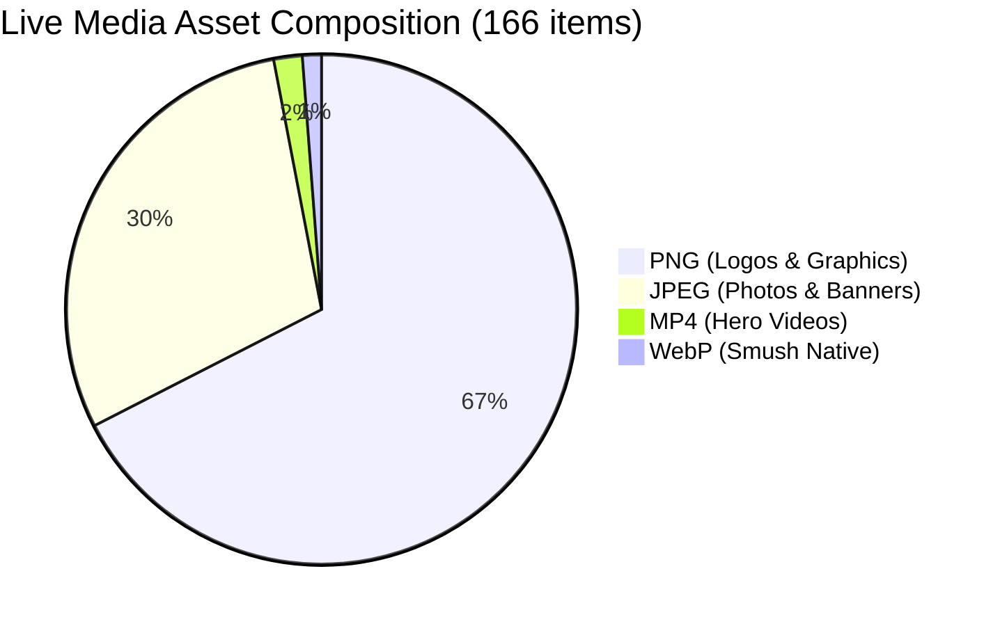

# MWHEBA 2.0 | Content and Media Asset Audit

**Document ID:** AUD-DOC-03  
**Phase:** Phase 0 (Discovery & Live-Site Audit)  
**Status:** Completed — Pending Owner Approval  
**Audit Target:** `https://mwheba.com/`  

---

## 1. Executive Summary: Content & Media Status

The public web audit revealed a distinct separation between high-value agency service copy / brand graphics and abandoned boilerplate demo data.

1. **Service Copywriting:** The six core service offerings (Brand Identity, Web Development, UI/UX Design, Digital Marketing, Media Production, Printing) contain thoughtful, custom-written agency copy in both Arabic and English. This is prime migration material for Phase 5. `[Verified]`
2. **Media Library:** 166 total media attachments exist on WordPress. Over 70% of these are client logos and UI icons. Three background MP4 videos are deployed. No legacy PDF downloads (company profile booklets or print catalogs) are hosted. `[Verified]`
3. **Demo Content:** The blog posts, WooCommerce products, and portfolio post types contain theme template demo data and should be discarded rather than migrated. `[Verified]`

---

## 2. Service & Page Content Audit

### A. Core Services Copy Assessment

| Service Name (EN / AR) | EN URL / AR URL | Word Count (EN / AR) | Content Quality & Scope | Migration Recommendation | Classification |
|---|---|---|---|---|---|
| **UI/UX Design** / تصميم واجهة المستخدم | `/services/ui-ux-design/` / `/ar/خدماتنا/تصميم-واجهة-المستخدم/` | ~380 / ~360 words | Professional agency pitch focusing on user journey, wireframing, interactive prototypes, and behavioral research. | **Migrate 1:1** to Payload `services` collection. | `Verified` |
| **Media Production** / إنتاج الوسائط | `/services/media-production/` / `/ar/خدماتنا/إنتاج-الوسائط/` | ~400 / ~380 words | Covers commercial photography, promotional videos, motion graphics, and audio mixing. | **Migrate 1:1** to Payload `services` collection. | `Verified` |
| **Web Development** / تطوير المواقع | `/services/web-development/` / `/ar/خدماتنا/تطوير-المواقع/` | ~410 / ~390 words | Emphasizes performance, security, modern architectures, scalability, and custom web applications. | **Migrate 1:1** to Payload `services` collection. | `Verified` |
| **Digital Marketing** / التسويق الرقمي | `/services/digital-marketing/` / `/ar/خدماتنا/التسويق-الرقمي/` | ~435 / ~410 words | Detailed strategy covering social media management, targeted ad campaigns (Meta, Google), email marketing, and conversion optimization. | **Migrate 1:1** to Payload `services` collection. | `Verified` |
| **Brand Identity** / هوية العلامة التجارية | `/services/brand-identity/` / `/ar/خدماتنا/هوية-العلامة-التجارية/` | ~450 / ~420 words | Full brand lifecycle: visual identity guides, typography, color palettes, tone of voice, and corporate stationery. | **Migrate 1:1** to Payload `services` collection. | `Verified` |
| **Printing & Giveaways** / الطباعة | `/services/printing/` / `/ar/خدماتنا/الطباعة/` | ~510 / ~480 words | Detailed breakdown of commercial offset/digital printing, corporate uniforms, VIP giveaways, promotional gifts, packaging, and exhibition stands. | **Migrate 1:1**; aligns directly with the B2B merchandise store. | `Verified` |

### B. Corporate & Institutional Pages

| Page | Status on Live Site | Content Audit & Gaps | Migration Recommendation | Classification |
|---|---|---|---|---|
| **About Us** (`/about/` & `/ar/عن-موهبة/`) | Published | Includes agency mission, vision, creative values, and a 22-logo client showcase grid. | **Migrate**; integrate client logos into CMS `partners` block. | `Verified` |
| **Contact Us** (`/contact-us/` & `/ar/تواصل-معنا/`) | Published | Contains Alexandria headquarters address, phone numbers `(+2) 01010944010`, `(+2) 01229609292`, email `info@mwheba.com`, operating hours (Sun–Thu 10am–6pm), and an Elementor lead capture form. | **Migrate copy & contact metadata**; replace form with Next.js Server Action form. | `Verified` |
| **Careers** (`/careers/` & `/ar/الوظائف/`) | Published | General call-to-action for talent; no active vacancy listings. | **Migrate template**; build CMS schema for open job postings. | `Verified` |
| **Our Projects** (`/our-projects/` & `/ar/مشاريعنا/`) | Empty Template | Grid shell exists but contains 0 project images and 0 case studies. | **Rebuild fresh** in Phase 5 with new case studies provided by stakeholder. | `Verified` |
| **Pricing** (`/pricing/`) | English Only | Static pricing table for basic packages; lacks Arabic mirror. | **Replaced** by MWHEBA 2.0 fixed-price service package catalog (D-003). | `Verified` |
| **Privacy Policy** & **Refund Policy** | Published | Standard bilingual boilerplate for corporate disclosures and returns. | **Migrate & Normalize** URLs (`/en/privacy-policy`, `/en/refund-policy`). | `Verified` |

---

## 3. Media & Creative Asset Catalog

WordPress REST API media introspection (`_fields=id,source_url,mime_type,title,slug,date`) cataloged all 166 stored assets:

### A. Asset Type Breakdown
- **PNG Images:** 112 items (mostly transparent brand logos, UI icons, and graphic overlays)
- **JPEG Images:** 49 items (photographs, banner backgrounds, testimonial portraits)
- **WebP Images:** 2 items (Smush native WebP conversion outputs)
- **MP4 Videos:** 3 items (background loop reels)
- **PDF Documents:** 0 items (no brochures or profiles found)



### B. Video Assets Discovered
Three MP4 video files are hosted in `wp-content/uploads/`:
1. `https://mwheba.com/wp-content/uploads/2025/08/BG.mp4` (~497 KB) — Clean looping geometric/abstract background.
2. `https://mwheba.com/wp-content/uploads/2025/07/1.mp4` (~4.47 MB) — Agency showcase reel.
3. `https://mwheba.com/wp-content/uploads/2025/07/الاسبورت2.mp4` — Motion graphics asset.

**Recommendation:** Do not serve 4.5 MB MP4 videos directly from Node.js or Git repository. Move all video assets to S3/CloudFront with modern AV1/WebM fallbacks and HLS streaming or optimized CDN delivery. `[Verified]`

### C. Client & Partner Brand Logos Cataloged
Twenty-two authentic client brand marks were extracted from the live site:
1. Oxford
2. Bico Misr
3. NASEC
4. Abo Fares
5. TrueDent
6. Maher
7. Tejanos
8. Al-Asala
9. Egy-Trans
10. Orouba
11. Pyramids
12. so5n-w-say7 (سخن و سايح)
13. EyeFree
14. Chicken Chester
15. ACC
16. Ashrakat
17. ESSP
18. Al-Kobtan
19. Mega-Pharm
20. Trust Dental
21. Shatby
22. AMI

**Quality Observation:** All 22 logos exist as transparent PNGs with standardized dimensions (processed through Smush/Elementor). Vector SVG versions of these logos are currently missing from public hosting and should be requested from the creative team during Phase 5. `[Verified]`

### D. Agency Branding Assets Cataloged
1. `Logo_MWHEBA-Wide-scaled.png`
2. `Logo-Wide-Inverted-e1754726255278.png`
3. `Logo-White-Wide-scaled-e1754724720286.png`
4. `MWHEBA-Hosting_Wide-small-e1754726236757.png`
5. `MWHEBA-Logo.jpg`

---

## 4. Target Object Storage (S3) Directory Plan

In accordance with architectural guidelines (assets stored in object storage, never in PostgreSQL), legacy assets will be ingested into AWS S3 (or Cloudflare R2) using the following structured bucket layout:

```
s3://mwheba-media-production/
├── branding/
│   ├── logos/
│   │   ├── mwheba-logo-light.svg
│   │   ├── mwheba-logo-dark.svg
│   │   └── mwheba-symbol.svg
│   └── favicons/
├── clients/
│   ├── oxford.png
│   ├── bico-misr.png
│   └── ... (22 client logos)
├── services/
│   ├── brand-identity/
│   ├── web-development/
│   ├── ui-ux-design/
│   ├── digital-marketing/
│   ├── media-production/
│   └── printing/
├── video/
│   ├── hero-bg.mp4
│   └── agency-showcase.mp4
└── catalog/
    ├── products/
    └── artwork-templates/
```

---
*Next Step: Evaluate technical SEO performance and historical indexing in `docs/audit/04-seo-baseline.md`.*
