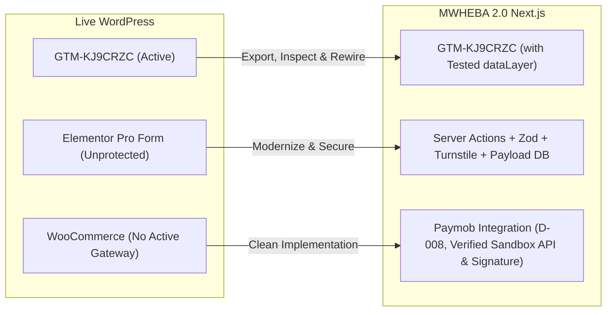

# MWHEBA 2.0 | Marketing, Tracking & Integrations Audit

**Document ID:** AUD-DOC-06  
**Phase:** Phase 0 (Discovery & Live-Site Audit)  
**Status:** Completed — Pending Owner Approval  
**Audit Target:** `https://mwheba.com/`  

---

## 1. Executive Summary: Tracking & Marketing Stack

A non-intrusive inspection of page sources and network assets across `https://mwheba.com/` was executed to catalog active marketing pixels, analytics engines, lead capture mechanisms, and third-party embeds.

The primary finding is that marketing script injection on `mwheba.com` is consolidated inside a single Google Tag Manager (GTM) container (`GTM-KJ9CRZC`). However, **simply embedding this container into Next.js does NOT guarantee conversion tracking continuity.** Because WordPress plugins (Elementor Pro Forms, WooCommerce) rely on WordPress-specific DOM triggers and legacy dataLayer pushes that do not exist in a Next.js App Router environment, tracking continuity requires container inspection, GA4/Pixel property verification, defining a new client/server dataLayer contract, and event-level validation.

---

## 2. Analytics & Tag Management Audit

| System / Tag | Identifier / Property | Location in Live Code | Status & Evidence | Classification |
|---|---|---|---|---|
| **Google Tag Manager** | `GTM-KJ9CRZC` | Embedded in `<head>` and `<noscript>` on all 35 pages | Container presence confirmed on production. Internal tag triggers and variables require container export. | `Verified` (Container) / `Requires Access` (Triggers) |
| **Google Analytics 4 (GA4)** | Property managed in GTM | Network traces and GTM container | Inferred to be managed inside `GTM-KJ9CRZC`. Requires container access to verify Measurement ID (`G-XXXXXXXXXX`). | `Inferred` / `Requires Access` |
| **Meta Pixel (Facebook)** | Container managed in GTM | Managed via GTM | No raw `fbq('init')` scripts detected in public DOM. Any active conversion pixels are managed via GTM. | `Inferred` / `Requires Access` |
| **Third-Party Heatmaps (Hotjar/Clarity)** | None detected | DOM inspection | No scripts matching Hotjar, Microsoft Clarity, or Crazy Egg were found. | `Verified` |
| **Live Chat / WhatsApp Widget** | None detected | DOM inspection | No floating WhatsApp button, Tidio, Crisp, or Intercom widget embedded on live site. | `Verified` |

### Required Action for Tracking Continuity & Event Testing (`Requires Access`)
To ensure complete continuity of conversion tracking without silent event failure:
1. **Container Export & Inspection:** Obtain read-only access or JSON export of `GTM-KJ9CRZC` to inspect active tags, trigger conditions, and custom variables.
2. **Property ID Verification:** Confirm the active GA4 Measurement ID and Meta Pixel ID with the agency marketing team.
3. **DataLayer Contract Specification:** Replace WordPress DOM-based event listeners with standard Next.js dataLayer events:
   - `contact_form_submitted` (lead generation)
   - `view_item` / `view_item_list` (catalog browsing)
   - `add_to_cart` (cart mutations with variant and price metadata)
   - `begin_checkout` (checkout initiation)
   - `purchase` (server-side and client-side verified transaction completion)
4. **Event-Level Testing:** Execute GTM Preview mode end-to-end verification during staging before cutover.

---

## 3. Lead Capture & Form Workflows

### A. Contact Us Form Inspection (`/contact-us/`)
Inspection of the live contact page revealed an active Elementor Pro Form widget:

- **Form Method:** `POST` via AJAX to `/wp-admin/admin-ajax.php`
- **Action Hook:** `action=elementor_pro_forms_send_form`
- **Field Catalog:**
  1. `form_fields[name]` — Full Name (Text, required)
  2. `form_fields[email]` — Email Address (Email, required)
  3. `form_fields[message]` — Project Brief / Inquiries (Textarea, required)
  4. Hidden security/session tokens: `post_id: 148`, `form_id: 4867566`, `queried_id: 148`
- **Anti-Spam Controls:** No Google reCAPTCHA v2/v3 or Cloudflare Turnstile script detected. The form currently lacks bot protection on the public endpoint. `[Verified]`
- **Live Submission Status:** **Not executed.** In strict compliance with Phase 0 execution rules, no dummy submissions were dispatched to live endpoints.

### B. Form Backend & Email Routing (`Requires Access`)
Because public inspection cannot determine the SMTP mailer backend, the following must be confirmed with the owner:
- Is lead notification email currently dispatched via native PHP `mail()`, or an authenticated transactional provider (Brevo, SendGrid, Amazon SES, Mailgun)?
- What recipient inbox receives incoming leads (`info@mwheba.com`, personal Gmail, CRM webhook)?

### C. MWHEBA 2.0 Target Architecture for Forms
In MWHEBA 2.0, contact inquiries will be handled by Next.js Server Actions:
- Submission validated via Zod schema (strict validation on Egyptian/international phone numbers, emails, and message lengths).
- Protected by Cloudflare Turnstile (invisible, zero-friction anti-bot protection).
- Dual persistence:
  1. Record saved directly into Payload CMS `inquiries` collection in PostgreSQL.
  2. Transactional email notification dispatched to agency managers via Resend or Amazon SES.

---

## 4. E-Commerce & Payment Integrations

Inspection of the WooCommerce checkout page (`https://mwheba.com/checkout/`) revealed:
- **Payment Gateways in DOM:** `payment_method` elements are empty. No active payment gateway (such as Paymob, Stripe, PayPal, or Bank Transfer) is rendered or configured for checkout. `[Verified]`
- **Currency Configuration:** `EGP` (Egyptian Pound) is the configured store currency. `[Verified]`
- **Taxes & Invoicing:** No electronic invoice plugin (ETA / Egyptian Tax Authority) is present. `[Verified]`
- **Alignment with DECISIONS.md & Paymob Integration Strategy:**
  - `D-008`: Paymob is confirmed as the primary online payment gateway.
  - `D-016`: Electronic invoicing (ETA) is strictly out of scope for MVP.
  - **Paymob API Versioning & Webhook Requirements:** Paymob maintains distinct integration models: modern Intention API and legacy Accept API. The exact transaction callback schema, header/body parameters, and cryptographic signature method (e.g. 20-field concatenated string vs Intention API signature) must be empirically determined and validated during the Phase 1 POC against live sandbox credentials and official documentation. Universal signature assumptions must not be hardcoded prior to sandbox testing.

---

## 5. Summary of Marketing Integration Actions

---
*Next Step: Operational gap analysis and decision cross-referencing in `docs/audit/07-business-gaps.md`.*
