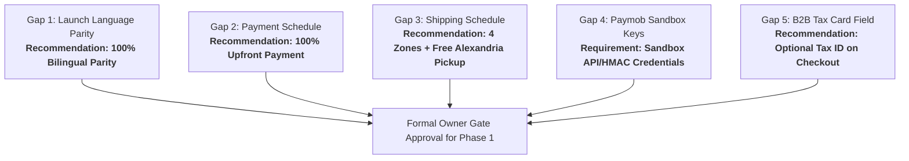

# MWHEBA 2.0 | Business & Operational Gap Analysis

**Document ID:** AUD-DOC-07  
**Phase:** Phase 0 (Discovery & Live-Site Audit)  
**Status:** Completed — Pending Owner Approval  
**Audit Target:** Cross-Reference with `DECISIONS.md` & Live Discoveries  

---

## 1. Executive Summary & Policy

In strict accordance with project rules, **approved business decisions are not reopened or re-litigated.** The architecture, payment provider, Minimum Order Quantity (MOQ) logic, printing pricing separation, inventory exclusion, tax exemption, and seamless checkout registration are finalized baseline contracts.

This gap analysis focuses strictly on **genuinely unresolved operational parameters** identified during the Phase 0 audit that are required for Phase 1 POC execution and Phase 2 foundational engineering.

---

## 2. Status of Approved Decisions (Non-Negotiable Baselines)

The following decisions from `DECISIONS.md` are cross-checked and locked:

| Decision ID | Topic | Confirmed Rule | Audit Validation |
|---|---|---|---|
| **D-001 - D-003** | Scope & Product Types | Agency website + B2B merchandise + Fixed-price services. No subscriptions. | Validated against existing agency services copy. |
| **D-004** | Architecture Core | Single Next.js app, single Payload CMS, single PostgreSQL database. | Clean slate; no legacy multi-tenant DB dependencies. |
| **D-008** | Payment Gateway | **Paymob** is the confirmed online gateway. | Verified live site has no competing gateway configured. |
| **D-009** | Minimum Order Quantity (MOQ) | **10 units per Product ID**; variant aggregation permitted (e.g. 5 Black + 5 White); cross-product aggregation strictly blocked. Cart mutations <10 allowed; checkout strictly blocked. | Server-side validation rules defined in `QUALITY_GATES.md`. |
| **D-010** | Line-Item Artwork | Custom logo/artwork attached to specific order item; stored in private S3 bucket. | Data model specified in `DATA_MODEL.md`. |
| **D-013** | Seamless Checkout Auth | Customer registers inline during checkout; password specified or passwordless. | Validated in checkout UX spec. |
| **D-015** | Delivery Methods | Standard shipping and agency office pickup (Miami, Alexandria). | Miami office location verified from live footer. |
| **D-016** | Invoicing Scope | **No ETA e-invoicing.** No PDF invoice generation engine in MVP. Maintain accurate database records. | Confirmed compliance with MVP scope. |
| **D-017** | Customization Pricing | Printing and engraving fees calculated and displayed separately from base product price. | Commerce pricing model locked. |
| **D-018** | Inventory Management | Stock tracking and warehouse management are **strictly out of scope** for MVP. | No stock count checks required at checkout. |

---

## 3. Separation: Technical POC Blockers vs. Production Business Policies

> [!IMPORTANT]
> **Clear Boundary:** A distinction must be maintained between **prerequisites required to start the Phase 1 technical POC** and **business policies required before production launch**. The Phase 1 POC evaluates technical capabilities (plugin extensibility, live API handshake, signature verification, MOQ hook enforcement). Unapproved commercial figures do not block starting the technical POC because they will be loaded via **configurable test fixtures**.

### A. The Single External Blocker to Start Phase 1 Technical POC

#### Technical Blocker: Paymob Sandbox Credentials (D-008 & AUD-04)
- **Status:** **CRITICAL TECHNICAL BLOCKER FOR POC**
- **Justification:** Scenarios POC-06, POC-07, and POC-08 require dispatching actual HTTP payloads to Paymob's sandbox endpoints and validating real webhook callbacks and HMAC cryptographic signatures. Without active developer test credentials, live gateway compatibility cannot be proven.
- **Required Credentials:**
  1. Paymob API Key (`PAYMOB_API_KEY`)
  2. Secret Key (`PAYMOB_SECRET_KEY`)
  3. Public Key (`PAYMOB_PUBLIC_KEY`)
  4. Integration IDs (Card Integration ID, Mobile Wallet Integration ID)
  5. HMAC Secret (`PAYMOB_HMAC_SECRET`)
- **Action Required:** Owner to provide sandbox credentials in a secure `.env.local` file.

---

### B. Business Policies Pending Owner Decision (Configurable in POC via Test Fixtures)

The following four items are commercial/operational policies that do not block starting the technical POC, but must be decided prior to Phase 4–6 production implementation:

#### Policy 1: Shipping & Delivery Rate Structure (D-015)
- **Status:** **PROPOSED OPERATIONAL POLICY (Non-Blocking for POC)**
- **Proposed Matrix (Subject to Owner Adjustment):**
  - Zone 1 (Alexandria): 60 EGP
  - Zone 2 (Greater Cairo & Giza): 80 EGP
  - Zone 3 (Delta & Canal Governorates): 90 EGP
  - Zone 4 (Upper Egypt & Red Sea): 120 EGP
  - Agency Office Pickup (Miami, Alexandria): 0 EGP (Free pickup)
- **POC Implementation:** The Phase 1 POC will implement a **configurable shipping rate fixture / dictionary**. The engine will accept any arbitrary governorate fee structure without architectural rewrites once approved.

#### Policy 2: Payment Schedule Policy (D-014)
- **Status:** **WORKING ASSUMPTION (Non-Blocking for POC)**
- **Baseline Assumption:** 100% full upfront payment at checkout.
- **Alternative:** Staged deposit model (e.g. 50% upfront, 50% before dispatch).
- **POC Implementation:** The Phase 1 POC will validate the standard full upfront payment transaction flow in Payload Ecommerce, while ensuring order state models cleanly separate Order Status from Payment Status to accommodate deposits if later mandated.

#### Policy 3: Launch Language Parity (D-012)
- **Status:** **PROPOSED CONTENT POLICY (Non-Blocking for POC)**
- **Proposed Scope:** 100% bilingual parity for corporate agency pages and B2B store catalog items at Day 1 launch.
- **POC Implementation:** The POC validates Payload localization capability on product schemas (`title`, `description`, `customizationLabel`).

#### Policy 4: Corporate Client Tax & Registration Document Review (D-016)
- **Status:** **LEGAL / ACCOUNTING POLICY (Non-Blocking for POC)**
- **Proposed Scope:** Add optional `taxRegistrationNumber` (البطاقة الضريبية) and `companyName` to B2B corporate checkout.
- **POC Implementation:** Implemented as optional schema fields on the POC customer checkout fixture.

---

## 4. Preservation of Confirmed Decisions
All confirmed decisions from `DECISIONS.md` remain immutable:
- **D-009 MOQ:** Strictly enforced at **10 units per Product ID**; variant aggregation permitted (e.g. 5 Black + 5 White mugs = valid); cross-product aggregation strictly blocked (5 of Product A + 5 of Product B = invalid). Cart mutations with <10 units persist; checkout and payment initiation are strictly blocked server-side.
- **D-010 Custom Artwork:** Attached to specific line item; stored in private S3 bucket.
- **D-017 Customization Pricing:** Printing/engraving fees calculated and itemized separately from base product price.

---

## 4. Summary Matrix of Owner Decision Items

---
*Next Step: Phase 1 Readiness Assessment and GO / NO-GO evaluation in `docs/audit/08-phase-1-readiness.md`.*
