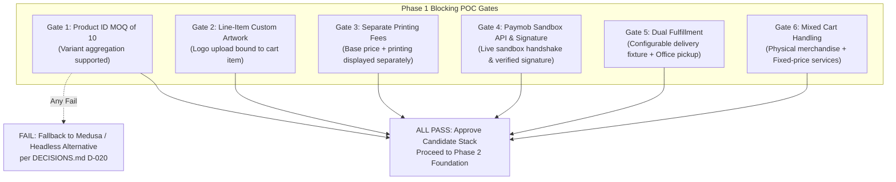

# MWHEBA 2.0 | Phase 1 Feasibility POC Readiness Assessment

**Document ID:** AUD-DOC-08  
**Phase:** Phase 0 Exit / Phase 1 Gate  
**Status:** Completed — Pending Owner Approval  
**Date:** November 2026  

---

## 1. Phase 0 Discovery & Audit Summary

Phase 0 has completed full execution in strict compliance with the read-only, non-intrusive operating rules. Public endpoints, sitemaps, headers, DOM structures, and WordPress REST API collections were audited without touching production infrastructure or submitting live forms.

### Audit Deliverables Completed:
1. `docs/audit/00-executive-summary.md` — Synthesized findings, architecture overview, and risk assessment.
2. `docs/audit/01-website-inventory.md` — Structural analysis of all 54 discoverable endpoints.
3. `docs/audit/02-url-inventory.csv` — Granular catalog (HTTP status, canonicals, H1s, titles, descriptions).
4. `docs/audit/03-content-and-media-audit.md` — Service copy evaluation, 166 media items, 22 client marks, 3 MP4 videos.
5. `docs/audit/04-seo-baseline.md` — Search health, missing hreflang and H1 gaps, crawl controls.
6. `docs/audit/05-redirect-map.csv` — Full 301 redirection matrix preserving legacy link equity.
7. `docs/audit/06-marketing-integrations.md` — GTM-KJ9CRZC verification, Elementor form audit, tracking migration plan.
8. `docs/audit/07-business-gaps.md` — Cross-check of confirmed decisions and operational parameters.
9. `docs/audit/08-phase-1-readiness.md` — This readiness assessment and gating recommendation.

---

## 2. Phase 1 Prerequisites & Readiness Checklist

### A. Technical POC Gating Items vs. Production Business Policies

| Dimension | Type | Status | Evidence / Implementation Rule | Action Required |
|---|---|---|---|---|
| **Paymob Sandbox Credentials** | Technical Prerequisite | **PENDING (Blocks Track 1B Only)** | Live sandbox payment (POC-06), idempotent webhook (POC-07), and signature verification require active sandbox keys. Track 1A (Commerce & MOQ sandbox) proceeds immediately without external keys. | **Owner to provide sandbox keys in `.env.local` prior to executing Track 1B.** |
| **Paymob API Version & Signature** | Technical Verification | **OPEN (Verified in POC)** | Intention API vs legacy Accept API and exact webhook signature calculation to be validated against live sandbox data. | Validated empirically during POC-TSK-04; no untested assumptions hardcoded. |
| **Legacy Commerce Data Verification** | Administrative Verification | **REQUIRES ACCESS (Non-Blocking for POC)** | Public catalog contains only 6 demo products. Administrative database checks for historical orders/customers require WP admin access. | Optional owner review before Phase 7; does not block Phase 1 sandbox. |
| **SEO 301 Redirection Plan** | SEO Governance | **PROPOSED DRAFT (Non-Blocking for POC)** | 54 discovered public URLs mapped to proposed targets in `05-redirect-map.csv` (using `PRESERVE`, `REDIRECT_301`, `GONE_410`). | Finalized against Google Search Console historical data in Phase 7. |
| **Marketing Tracking Continuity** | Analytics Architecture | **REQUIRES GTM AUDIT (Non-Blocking for POC)** | GTM container `GTM-KJ9CRZC` is active. GTM container export, GA4/Pixel ID confirmation, and dataLayer contract required. | Conduct GTM container audit and event-level testing during Phase 3–4. |
| **Shipping Rate Schedule** | Commercial Policy | **CONFIGURABLE FIXTURE (Non-Blocking for POC)** | Governorate fee proposals (60/80/90/120 EGP) and free pickup are working proposals pending owner decision. | POC implements a **configurable shipping rate fixture** accepting any rates. |
| **Payment Schedule (Upfront vs Deposit)** | Commercial Policy | **CONFIGURABLE FIXTURE (Non-Blocking for POC)** | 100% upfront payment is a working assumption (D-014) pending formal sign-off. | POC implements standard full payment fixture with decoupled order/payment states. |
| **Core Service Content Assets** | Content Governance | **VERIFIED IN AUDIT** | 6 primary service offerings cataloged with high-quality bilingual copywriting; 22 client logos verified. | Ready for ingestion into Payload CMS in Phase 4. |

---

## 3. Phase 1 Feasibility POC Blocking Pass/Fail Criteria

Before writing production application code or committing to the candidate stack (Next.js + Payload CMS + Payload Ecommerce candidate), Phase 1 must prove the following six non-negotiable gates across 12 mandatory blocking scenarios in an isolated POC environment:



1. **Gate 1 (MOQ of 10 per Product ID):** Must prove that a customer can add 4 Red and 6 Blue mugs of Product ID #101 to reach the 10-unit minimum (POC-01), while incomplete quantities persist in cart (POC-02) and cross-product aggregation is strictly blocked server-side (POC-02B).
2. **Gate 2 (Line-Item Artwork):** Must prove custom branding files (SVG/PNG/PDF) can be attached to individual cart items and persisted into the order snapshot in private storage (POC-03).
3. **Gate 3 (Separate Printing Fees):** Must prove printing and engraving add-on charges calculate dynamically and display as distinct breakdown items, not bundled into base product pricing (POC-TSK-02).
4. **Gate 4 (Paymob Integration & Multi-Assertion Confirmation):** Must execute a real sandbox card/wallet payment against Paymob's live sandbox API, successfully verifying the cryptographic callback signature, `success` state, penny-perfect amount matching, currency matching, order correlation, and resilient concurrency/retry handling (POC-06, POC-07, POC-08).
5. **Gate 5 (Dual Fulfillment):** Must prove checkout handles both shipping (using a configurable governorate test fixture) and local pickup from MWHEBA's Miami, Alexandria office.
6. **Gate 6 (Mixed Cart):** Must prove a single order can contain both customized physical merchandise lines and a fixed-price agency service package (POC-05).

---

## 4. Revised Phase 0 Exit Recommendation & Phase 1 Entry Checklist

### A. Recommendation
We recommend a **CONDITIONAL AUTHORIZATION** to execute **Phase 1: Commerce Feasibility POC (Track 1A only)** following plan correction sign-off.
- The discovery and audit phase has successfully mapped the public site footprint (54 discoverable URLs), resolved the Arabic URL canonical/metadata behavior, cataloged 166 media items and 22 client logos, established a 4-tier proposed redirect matrix, and identified the exact technical prerequisites for the POC.
- Unapproved commercial policies (shipping fees, payment schedule, corporate tax fields) do NOT block starting the technical POC; they will be loaded as configurable fixtures.
- Full project implementation remains strictly blocked until both Track 1A and Track 1B pass all 12 blocking gates cleanly.

### B. Precise Phase 1 Entry Checklist
To execute the isolated Phase 1 sandbox:
1. **[PLAN CORRECTION GATE — PREREQUISITE TO TRACK 1A]** Finalize all plan corrections (payment confirmation multi-assertion pipeline, webhook concurrency resilience, 4-tier SEO status tests, and spec unification). Once validated, execute Phase 1 Track 1A POC in isolated sandbox `poc/`.
2. **[PENDING FOR TRACK 1B]** Project owner provides Paymob Sandbox developer credentials in `poc/.env.local` prior to initiating live payment gateway tests:
   - `PAYMOB_API_KEY`
   - `PAYMOB_SECRET_KEY`
   - `PAYMOB_HMAC_SECRET`
   - `Card Integration ID` & `Mobile Wallet Integration ID`
3. **[ADMINISTRATIVE PRE-LAUNCH CHECKS]** Historical WooCommerce backend orders/customers, GTM container export, and Google Search Console performance data remain scheduled for verification before Phase 7 cutover and do not block Phase 1.

---

## 5. Explicit Approval Gate

In accordance with `AGENTS.md` and Phase 0 execution boundaries:
- **No application code has been written.**
- **No framework dependencies or packages have been installed.**
- **No production systems, DNS records, or live databases were altered.**
- **Work is halted immediately pending explicit owner sign-off.**

```
Awaiting approval to implement
```
