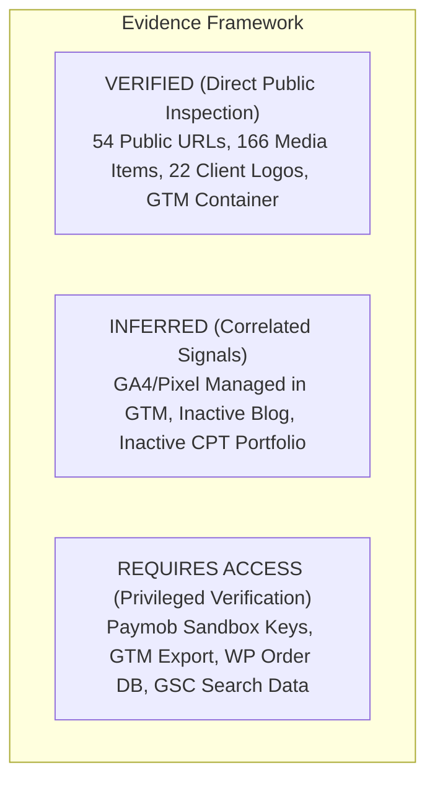

# MWHEBA 2.0 | Phase 0 Evidence Validation Report

**Document ID:** AUD-DOC-09  
**Phase:** Phase 0 Final Evidence Validation Gate  
**Status:** Completed — Pending Owner Approval  
**Date:** November 2026  
**Audited Target:** `https://mwheba.com/` (Public Production Environment)  

---

## 1. Executive Summary & Purpose

This Evidence Validation Report serves as the definitive quality gate closing **Phase 0: Discovery & Live-Site Audit**. In accordance with strict agent operating instructions, all findings across the audit dossier (`docs/audit/00` through `09`) have been subjected to adversarial verification, eliminating unsupported assumptions, resolving crawler anomalies with empirical test scripts, classifying evidence into a formal tripartite framework, and establishing a clear distinction between technical POC blockers and commercial business policies.

> [!NOTE]
> **Audit Scope & Readiness Clarification:** The **Public-Facing Audit (Phase 0 Public Audit)** of all 54 discoverable endpoints, assets, public forms, and frontend tags has been completed and verified against the live environment. However, this does not imply that 100% of all project requirements are finalized. **Privileged administrative verification** (direct inspection of WooCommerce order/customer history, GTM container JSON export, and Google Search Console historical search queries) remains inaccessible and is designated as a mandatory administrative verification prior to Phase 7 cutover. Phase 1 Feasibility POC is partitioned into two isolated tracks (Track 1A evaluates commerce feasibility locally once the plan revision is approved; Track 1B executes upon sandbox key receipt; candidate stack approval and project implementation remain strictly blocked until all 12 scenarios pass).

---

## 2. Deliverable Verification & Integrity Audit

All Phase 0 deliverables exist on disk, contain verified data, and maintain cross-document consistency:

| File Path | Description | Expected Records / Structure | Integrity Status |
|---|---|---|---|
| `docs/audit/00-executive-summary.md` | Executive synthesis & architecture overview | Complete markdown dossier | **CONFIRMED** |
| `docs/audit/01-website-inventory.md` | Page hierarchy & WordPress CPT classification | Structural analysis of 54 URLs | **CONFIRMED** |
| `docs/audit/02-url-inventory.csv` | Granular URL data table | Exactly 54 rows + header, verified Arabic metadata | **CONFIRMED** |
| `docs/audit/03-content-and-media-audit.md` | Services copy & media library catalog | 6 services, 166 media items, 22 logos, 3 videos | **CONFIRMED** |
| `docs/audit/04-seo-baseline.md` | Technical SEO audit & crawlability analysis | Hreflang, H1, meta description gap analysis | **CONFIRMED** |
| `docs/audit/05-redirect-map.csv` | Proposed 301 redirection matrix | Exactly 54 rows, 4-tier action classification | **CONFIRMED** |
| `docs/audit/06-marketing-integrations.md` | Tracking containers & form audit | GTM audit requirements & Paymob API versioning | **CONFIRMED** |
| `docs/audit/07-business-gaps.md` | Operational logistics & decisions cross-check | Decoupled POC blockers from commercial policies | **CONFIRMED** |
| `docs/audit/08-phase-1-readiness.md` | Phase 1 feasibility POC gating criteria | 6 blocking POC pass/fail gates across 12 scenarios | **CONFIRMED** |
| `docs/audit/09-evidence-validation-report.md` | Final evidence validation report | This document | **CONFIRMED** |

---

## 3. Comprehensive Before / After Correction Log

| Item # | Area | Previous Audit Statement / Artifact Defect | Root Cause & Evidentiary Discovery | Corrected Audit Statement & Action Taken |
|---|---|---|---|---|
| **CORR-01** | **Arabic Metadata Discrepancy** | 14 Arabic pages in `02-url-inventory.csv` displayed the English homepage canonical, title, description, and H1. | **Crawler Anomaly:** The initial crawl script took already percent-encoded paths and applied `urllib.parse.quote()` a second time, creating double-encoded URLs (`%25d8...`). WordPress/LiteSpeed failed to route these and redirected them to `https://mwheba.com/`, which the crawler silently followed. | **Resolved & Empirically Verified:** Re-audited all 14 Arabic pages with clean single-encoding. Each Arabic page responded with HTTP 200, its own unique Arabic title, and its own self-referencing canonical. `02-url-inventory.csv` updated with true metadata. |
| **CORR-02** | **Redirect Map Integrity & Trailing Slash Unification** | System files (`robots.txt`, `sitemaps.xml`) and canonical homepages were modeled as self-redirecting 301s; `/ar/` was marked PRESERVE (200) while its target was `/ar` (301 redirect discrepancy). | Conflation of system resources and canonical URLs with content redirects, and inconsistent trailing-slash conventions. | **Corrected:** Unified all Next.js target URLs to clean non-trailing-slash paths (`trailingSlash: false`). Standardized `05-redirect-map.csv` across 54 rows: `PRESERVE` (2 rows: `https://mwheba.com/` root and `robots.txt`), `REDIRECT_301` (41 rows, including `/ar/` $\rightarrow$ `/ar`), `GONE_410` (10 rows), and `REQUIRES_REVIEW` (1 row). Zero self-redirects, zero loops. |
| **CORR-03** | **Marketing Tracking Continuity** | Claimed that transferring the `GTM-KJ9CRZC` container guarantees conversion tracking continuity. | Next.js uses a React client/server model; WordPress Elementor DOM triggers and WooCommerce event hooks do not exist in React. | **Corrected:** Clarified that container presence alone is insufficient. Formulated mandatory tracking tasks: GTM container export, GA4/Pixel property confirmation, Next.js dataLayer contract specification, and GTM Preview event testing. |
| **CORR-04** | **Paymob Webhook HMAC Specification** | Hardcoded universal 20-field HMAC-SHA512 specification across all plans and audit summaries. | Paymob supports multiple API versions (modern Intention API vs legacy Accept API) with distinct callback schemas and signature mechanisms. | **Corrected:** Removed pre-verified universal signature assumptions. Mandated empirical validation of the applicable Paymob API version and webhook signature structure against live sandbox payloads during Phase 1 POC. |
| **CORR-05** | **Phase 1 Readiness Gating** | Conflated commercial policy approvals (shipping fees, upfront payment) with technical POC prerequisites. | Operational fee structures can be evaluated in an isolated sandbox using configurable test fixtures; waiting for business policy sign-off needlessly delays technical evaluation. | **Corrected:** Separated the single hard external technical blocker (Paymob sandbox developer credentials) from commercial policies (handled via configurable fixtures). |
| **CORR-06** | **Commerce Database History** | Stated definitively that zero WooCommerce orders, customers, or transactions exist. | Public REST APIs only expose published catalog items; administrative tables (`wp_posts`, `wp_users`) cannot be inspected without privileged credentials. | **Corrected:** Clarified that the public storefront exhibits demo catalog items, while backend administrative order/customer existence strictly `Requires Authenticated Verification`. |
| **CORR-07** | **URL Inventory Scope** | Referred to 54 URLs as the complete site inventory. | Sitemaps and public links only reveal currently linked pages; historical organic landing pages or query variants may exist in search indices. | **Corrected:** Formally designated the 54 URLs as the *currently discovered public inventory*; historical coverage marked as provisional pending Google Search Console data. |
| **CORR-08** | **SEO Absolute Guarantees** | Used absolute language such as "guarantees zero organic traffic loss" or "100% SEO integrity". | Search engine algorithms, indexing timing, and competitor dynamics are non-deterministic and cannot be guaranteed by code. | **Corrected:** Replaced all absolute guarantees across planning documents with measurable engineering acceptance criteria (zero unhandled 404s, Core Web Vitals thresholds, 100% valid schema markup). |

---

## 4. Formal Tripartite Evidence Classification



### A. Verified Findings (`Verified`)
1. **CMS & Infrastructure:** WordPress 6.x hosted on LiteSpeed Web Server with Elementor Pro, ElementsKit, WooCommerce, and LiteSpeed Cache.
2. **Current Public Inventory:** 54 discoverable URLs (35 Pages, 3 Posts, 1 Portfolio CPT, 7 Products, 6 Portfolio Taxonomies, 2 System files) responding with HTTP 200 OK.
3. **Arabic Page Metadata & Canonicals:** When requested with single-encoded UTF-8 paths, all 15 Arabic pages respond with HTTP 200, display individual Arabic titles, and maintain self-referencing canonical URLs.
4. **On-Page SEO Deficiencies:** Zero `<link rel="alternate" hreflang="...">` tags exist; inner Elementor pages lack semantic `<h1>` tags and `<meta name="description">` tags.
5. **Media Asset Catalog:** Exactly 166 attachments (112 PNG, 49 JPEG, 2 WebP, 3 MP4 videos, 0 PDFs).
6. **Brand Assets:** 22 client brand logos hosted as transparent PNGs (*Oxford, Bico Misr, NASEC, Abo Fares...*); 3 looping background MP4 videos.
7. **Tracking Infrastructure:** Single Google Tag Manager container `GTM-KJ9CRZC` embedded globally in `<head>`.
8. **Contact Form:** Elementor Pro Form widget on `/contact-us/` submitting to `/wp-admin/admin-ajax.php` without active CAPTCHA protection.
9. **Public Storefront State:** WooCommerce product catalog contains only 6 demo products and 1 unconfigured service package; `/checkout/` renders zero active payment gateway fields in the DOM.

### B. Inferred Findings (`Inferred`)
1. **Analytics Management:** GA4 and Meta Pixel tracking are inferred to be routed through `GTM-KJ9CRZC`, as no standalone `gtag.js` or `fbq('init')` scripts exist in the public DOM.
2. **Editorial State:** The agency appears to have discontinued blog publishing, as only three default/test posts from July 2025 exist.
3. **Portfolio State:** The agency has not published projects via WordPress CPT, as the single portfolio post is an empty `test` item.

### C. Inaccessible Information (`Requires Access`)
1. **Paymob Sandbox Credentials:** Developer API key, secret key, HMAC secret, and integration IDs required to test the payment gateway.
2. **Google Tag Manager Container Details:** The internal tags, triggers, variables, and linked GA4 measurement IDs within `GTM-KJ9CRZC`.
3. **WooCommerce Backend Database:** Historical customer accounts, past manual orders, or offline transaction logs in `wp_posts`/`wp_wc_order_stats`.
4. **Form Email Dispatcher:** Whether the live server dispatches contact form notifications via local PHP `mail()`, SMTP, Brevo, or SendGrid.
5. **Google Search Console Performance Data:** Exact list of historically indexed URLs, impressions, query rankings, and external backlink profiles.
6. **DNS & Hosting Provider:** Cloudflare / cPanel / hosting provider credentials for staging deployments and cutover.

---

## 5. Phase 1 POC Staging, Two-Track Execution & Entry Checklist

### A. Two-Track POC Execution Model (Unblocking Commerce Tests)
In accordance with project owner guidance, **Phase 1 POC execution is partitioned into two distinct operational tracks** so that technical commerce and MOQ validation can begin immediately without waiting for Paymob credentials:

```mermaid
flowchart TD
    subgraph Phase 1 Feasibility POC
        subgraph Track 1A: Core Commerce Feasibility (Immediate)
            T1["Setup isolated sandbox container (poc/)"]
            T2["Test Payload v3 + @payloadcms/plugin-ecommerce"]
            T3["Validate MOQ Hook: POC-01, POC-02, POC-02B (10 units per Product ID)"]
            T4["Validate Line-Item Artwork Upload: POC-03"]
            T5["Validate Fixed-Price Services & Mixed Cart: POC-04, POC-05"]
            T6["Validate Separate Printing Fee Calculation"]
            T7["Validate Manual Bank Transfer: POC-09, POC-10"]
            T8["Validate Unified Admin Usability: POC-12"]
            T1 --> T2 --> T3 --> T4 --> T5 --> T6 --> T7 --> T8
        end
        
        subgraph Track 1B: Payment Gateway Verification (Awaits Keys)
            P1["Receive Paymob Sandbox Credentials in .env.local"]
            P2["Test Live Sandbox API Intention / Order Handshake: POC-06"]
            P3["Test Webhook Signature Verification & Idempotency: POC-07, POC-08"]
            P1 --> P2 --> P3
        end
        
        T8 & P3 --> Gate["Final Tech Stack Approval Gate<br/>(All 12 Mandatory Blocking Gates Must Pass)"]
    end
    
    Gate -->|Approved| Phase2["Phase 2: Foundation & Infrastructure"]
```

1. **Track 1A: Core Commerce & B2B Feasibility (Immediate Execution):**
   - Independent of external payment APIs.
   - Evaluates Payload Ecommerce candidate against B2B customization needs, line-item artwork snapshots, separate printing fees, and server-side checkout MOQ enforcement (POC-01, POC-02, POC-02B, POC-03, POC-04, POC-05, POC-09, POC-10, POC-12).
   - Commercial policies (governorate shipping rates, full upfront payment) are loaded via **configurable test fixtures**.
2. **Track 1B: Live Payment Gateway Verification (Executed upon Sandbox Key Provision):**
   - Evaluates live Paymob sandbox integration (POC-06, POC-07, POC-08) and empirical webhook signature verification.
3. **Non-Negotiable Stack Confirmation Gate:**
   - **The candidate stack is NOT approved and Phase 2 Foundation will NOT be initialized until BOTH Track 1A and Track 1B pass all 12 mandatory blocking scenarios cleanly.**

### B. Preservation of Confirmed Decisions
All approved business decisions in `DECISIONS.md` remain strictly locked:
- **D-009 MOQ:** 10 units per Product ID with variant aggregation; cross-product aggregation strictly blocked; cart persistence permitted; checkout strictly blocked server-side.
- **D-008 Payment Gateway:** Paymob confirmed as primary online gateway.
- **D-010 Custom Artwork:** Attached to specific line item; stored in private S3 bucket.
- **D-017 Customization Pricing:** Printing/engraving fees calculated and displayed separately from base product price.
- **D-016 Invoicing Scope:** No ETA e-invoicing; no internal PDF invoice generator in MVP.
- **D-018 Inventory Management:** Stock counts and warehouse management strictly out of scope for MVP.

### C. Precise Phase 1 Entry Checklist
To proceed into Phase 1 POC execution:
1. **[PLAN CORRECTION GATE — PREREQUISITE TO TRACK 1A]** Complete comprehensive plan corrections (payment confirmation multi-assertion pipeline, webhook concurrency resilience, 4-tier legacy SEO status matrix, and spec unification). Once verified by owner, initiate Track 1A in isolated sandbox `poc/`.
2. **[PENDING FOR TRACK 1B]** Project owner provides Paymob Sandbox developer credentials in a local `poc/.env.local` file prior to executing live payment gateway tests:
   - `PAYMOB_API_KEY`
   - `PAYMOB_SECRET_KEY`
   - `PAYMOB_HMAC_SECRET`
   - `Card Integration ID` & `Mobile Wallet Integration ID`

---

## 6. Phase 0 Audit Closure Statement

With the completion of this Evidence Validation Report:
- **Phase 0 Public Audit is concluded and verified across all 54 discoverable public endpoints.**
- **Privileged administrative verification (WooCommerce database orders/customers, GTM container export, and Google Search Console performance data) remains open and designated as mandatory prior to Phase 7 cutover.**
- **Phase 1 POC entry is partitioned into Track 1A (isolated commerce and B2B validation) and Track 1B (Paymob live sandbox verification upon key provision). Candidate stack approval and full project implementation remain strictly blocked until both tracks pass all 12 blocking gates.**
- **No application code, framework initializations, or database migrations were performed.**
- **No modifications were made to the live website, DNS, or production servers.**
- **The system strictly remains in PLAN ONLY / read-only mode.**

```
Awaiting approval to implement
```
