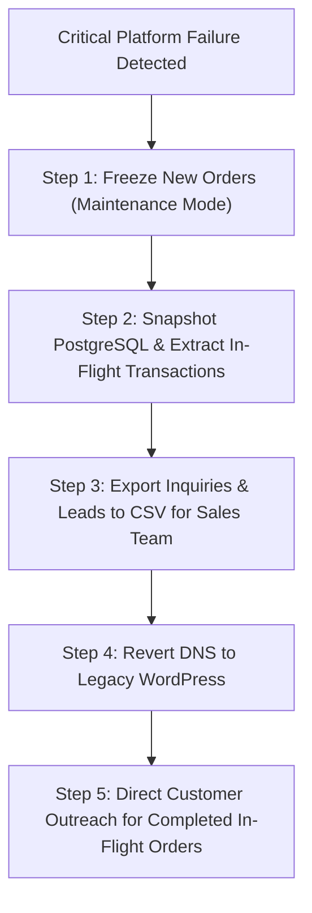

# MWHEBA 2.0 | Production Cutover Protocol & Transaction Reconciliation

**Document Version:** 1.0.0  
**Phase:** Phase 8 Launch  
**Authority:** MWHEBA Agency Leadership  

---

## 1. Executive Summary & Core Principles

A production launch of an e-commerce platform with B2B corporate customers and custom print manufacturing requires a zero-downtime, zero-data-loss cutover. 

> [!CRITICAL]
> **DNS switching alone is NEVER an acceptable rollback strategy.**  
> DNS propagation delays vary unpredictably across regional Egyptian telecom providers (WE, Vodafone, Orange, Etisalat) and corporate DNS caches regardless of configured TTL values. A naive DNS reversal after transactions have commenced causes catastrophic data desynchronization (customers charged on gateways/wires without records on legacy systems).

Every step of this runbook enforces server-authoritative integrity, explicit 10-unit MOQ compliance, and bidirectional reconciliation.

---

## 2. Pre-Cutover Readiness Checklist (-48h to T-0)

| Phase | Time Window | Task | Responsible | Verification |
|---|---|---|---|---|
| **Pre-Cutover** | T-48 Hours | Lower DNS TTL to 300 seconds across Cloudflare / Namecheap / Hostinger DNS | DevOps | `dig mwheba.com +nocmd +noall +answer` returns TTL 300 |
| **Pre-Cutover** | T-24 Hours | Complete staging acceptance tests across all 28 test suites (430+ automated tests) | QA Agent | `npm test` exit code 0 |
| **Pre-Cutover** | T-2 Hours | Perform incremental database backup (`src/scripts/ops/backup.sh`) | DevOps | SHA-256 digest verified |
| **Pre-Cutover** | T-1 Hour | Place legacy WordPress site in **Read-Only / Maintenance Mode** (disable contact forms) | Webmaster | Form submissions return maintenance message |
| **Pre-Cutover** | T-30 Mins | Verify private upload storage directory permissions outside public web root | DevOps | `chmod 700 storage/` verified |

---

## 3. Cutover Execution Protocol (T-0 to T+60 Mins)

### Step 1: DNS Record Cutover
Update DNS A / CNAME records to point `@` and `www` to the new Next.js production server.

### Step 2: SSL & Health Verification
1. Verify SSL certificate issuance:
   ```bash
   curl -Iv https://mwheba.com/api/health
   ```
2. Assert HTTP 200 JSON health response:
   ```json
   { "status": "ok", "uptime": 120 }
   ```

### Step 3: Edge Redirect Matrix Verification
Run automated crawl across the 4-tier legacy matrix:
- **PRESERVE (2 URLs):** Returns HTTP 200 (`/ar`, `/en`).
- **REDIRECT_301 (41 URLs):** Returns HTTP 301 to clean non-trailing-slash target with `Cache-Control: public, max-age=31536000, immutable`.
- **GONE_410 (10 URLs):** Returns HTTP 410 with `X-Robots-Tag: noindex, nofollow`.
- **REQUIRES_REVIEW (1 URL):** Returns HTTP 302 with `Cache-Control: no-store` and `X-Redirect-Status: pending_owner_review`.

### Step 4: Compliant Internal Smoke Test
Execute 1 live end-to-end smoke test strictly adhering to business invariants:
- **SKU:** Authorized Internal Testing SKU (`TEST-MUG-001`).
- **Quantity:** **Strictly 10 units** (respecting the mandatory 10-unit Product ID MOQ).
- **Payment:** Test Bank Transfer or Authorized COD delivery run.
- **Verification:** Verify order snapshot frozen in `orders` table, fulfillment jobs created, and financial ledger balanced.

---

## 4. Realistic Rollback & Transaction Reconciliation Strategy

If an unrecoverable failure occurs during the cutover window (e.g. fatal database deadlock or critical host connectivity loss):



### 4.1 Step 1: Freeze In-Flight Traffic
Immediately set `MAINTENANCE_MODE=true` on the Next.js server to prevent any new orders from being submitted while in-flight transactions are cleared.

### 4.2 Step 2: Transaction Audit & Ledger Snapshot
Extract all orders placed during the cutover window:
```sql
SELECT id, order_number, total, payment_method, payment_status, customer_email, created_at
FROM orders
WHERE created_at >= NOW() - INTERVAL '4 hours'
ORDER BY created_at DESC;
```

### 4.3 Step 3: Lead & Inquiry Reconciliation Export
Export all newly submitted leads to CSV to ensure zero client inquiries are lost during DNS reversion:
```sql
COPY (
  SELECT id, full_name, email, phone, company_name, project_details, created_at
  FROM inquiries
  WHERE created_at >= NOW() - INTERVAL '4 hours'
) TO '/backups/mwheba/inquiries_cutover_export.csv' WITH CSV HEADER;
```

### 4.4 Step 4: DNS Reversion
Revert DNS records to legacy server IP. Maintain monitoring for 48 hours while ISP DNS caches clear.

### 4.5 Step 5: Customer Outreach Protocol
For any customer who successfully submitted an order during the window:
- Operations and Finance teams contact the customer via phone and verified email within 1 hour.
- Provide full transaction details and confirm order fulfillment manually through agency workshop channels.
